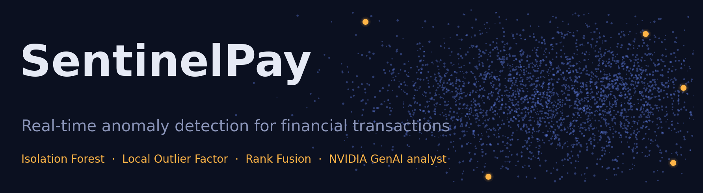
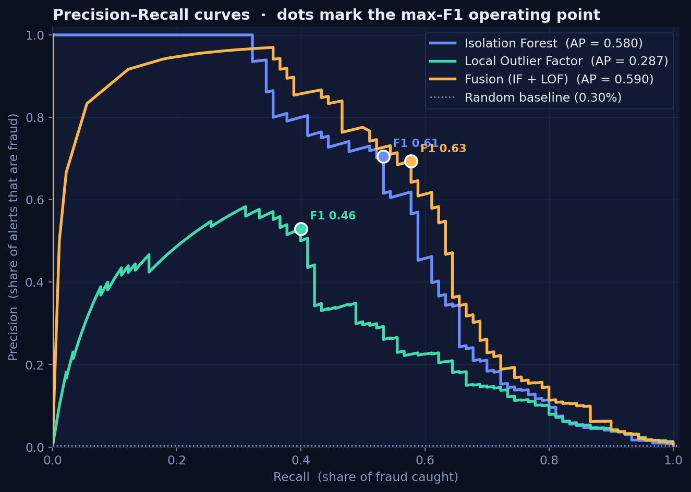
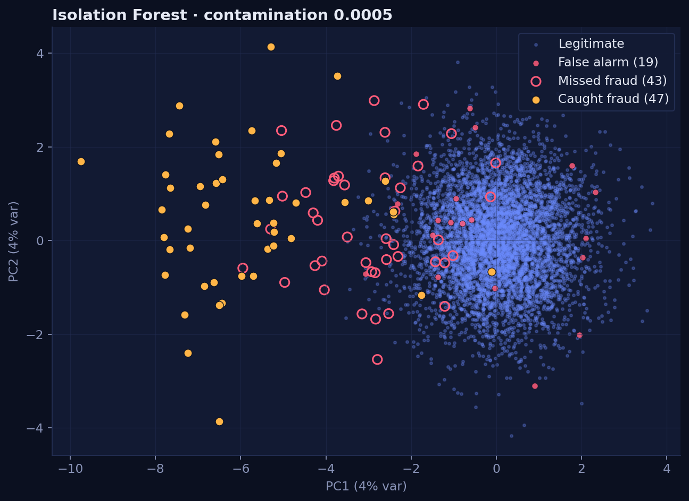
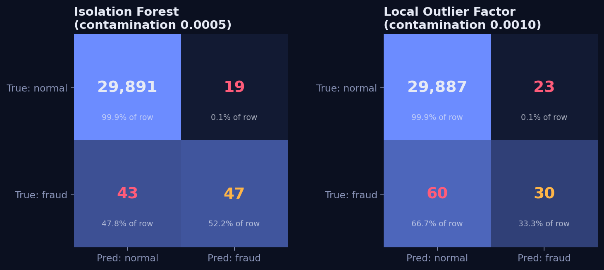
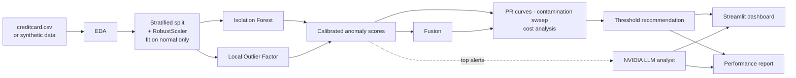

<p align="center"></p>

<p align="center">
  
  
  
  
  
</p>

# SentinelPay — Real-Time Anomaly Detection in Financial Transactions

An **unsupervised fraud-detection system** for the fictional FinTech *SecurePay*. Instead of teaching a model what fraud looks like
(it changes constantly), SentinelPay learns what **normal** looks like and flags whatever deviates — then uses an **NVIDIA-hosted LLM**
to explain each alert in plain English.

> **Why not a classifier?** Fraud is ~0.1–0.3 % of transactions. A model that always answers "legitimate" scores **99.7 % accuracy** and
> catches **zero** fraud. Accuracy is the wrong metric, so SentinelPay is judged on **precision, recall, F1 and PR-AUC**.

---

## Highlights

| | |
|---|---|
| **Two detectors, side by side** | Isolation Forest (tree / path length) and Local Outlier Factor (local density) — plus a calibrated **rank-fusion** ensemble |
| **Trained on normal data only** | True to the brief: the baseline of acceptable behaviour is learned without fraud labels |
| **`RobustScaler`** | Median/IQR scaling, fitted on normal training rows only → **no leakage** |
| **Label-free threshold calibration** | `contamination` becomes a quantile of held-out *normal* scores, so the false-positive rate ≈ contamination |
| **Business-aware tuning** | PR curves, max-F1, target-recall, and a **dollar-cost** operating point (missed fraud vs. review cost) |
| **NVIDIA GenAI analyst** | Explains alerts, writes the executive summary, answers questions — with an **offline fallback** so nothing breaks without a key |
| **Interactive dashboard** | Dark, glass-style Streamlit app with live contamination slider, PCA maps and confusion matrices |
| **Reproducible** | One command regenerates every figure, the metrics JSON and the report; unit-tested |

## Results (hold-out set: 30,000 transactions, 90 fraud)

> ⚠️ Numbers below come from the bundled **synthetic ULB-style data** so the repo runs anywhere. Drop the real Kaggle
> `creditcard.csv` into `data/` and re-run to get your final figures (see [`data/README.md`](data/README.md)).

| Model | PR-AUC | ROC-AUC | Best F1 | Fit + score time | Latency / txn |
|---|---|---|---|---|---|
| **Isolation Forest** | **0.580** | 0.974 | 0.608 | **0.7 s** | **0.009 ms** |
| Local Outlier Factor | 0.287 | 0.979 | 0.456 | 4.9 s | 0.092 ms |
| Fusion (IF + LOF) | 0.590 | 0.982 | 0.630 | 5.6 s | 0.101 ms |

**Recommendation → Isolation Forest.** Fusion is only 0.01 PR-AUC better but ~11× slower at scoring, so the real-time constraint decides.

| Operating point (Isolation Forest) | contamination | Recall | Precision | False alarms | FPR |
|---|---|---|---|---|---|
| Balanced — max F1 | 0.0005 | 52 % | 71 % | 19 | 0.06 % |
| Cost-optimal ($) | 0.0075 | 68 % | 22 % | 212 | 0.71 % |
| Compliance — recall ≥ 80 % | 0.0300 | 82 % | 7 % | 913 | 3.05 % |

<p align="center"> </p>
<p align="center"></p>

Full write-up: [`reports/Performance_Analysis_Report.md`](reports/Performance_Analysis_Report.md)

## Architecture



## Quick start

```bash
git clone <your-repo-url> sentinelpay && cd sentinelpay
python -m venv .venv && source .venv/bin/activate        # Windows: .venv\Scripts\activate
pip install -r requirements.txt

python run_pipeline.py            # figures + metrics.json + Performance_Analysis_Report.md
streamlit run app/dashboard.py    # interactive dashboard
jupyter lab notebooks/SentinelPay_Analysis.ipynb
```

### Enable the NVIDIA GenAI analyst

1. Create a free API key at <https://build.nvidia.com> (Profile → *API Keys*; it starts with `nvapi-`).
2. `cp .env.example .env` and paste the key into `NVIDIA_API_KEY`.
3. Restart the dashboard — the header badge turns green. Pick any alert in **AI analyst → Explain with NVIDIA AI**.

The client talks to NVIDIA's OpenAI-compatible endpoint (`https://integrate.api.nvidia.com/v1`, default model
`meta/llama-3.3-70b-instruct`, override with `NVIDIA_MODEL`). **Privacy:** only anonymised PCA features, scores and aggregate metrics
are sent — never raw card data. If the key is missing or a call fails, a deterministic rule-based explanation is used instead.

### Use the real dataset

Download the [ULB credit-card fraud data](https://www.kaggle.com/datasets/mlg-ulb/creditcardfraud) to `data/creditcard.csv`, then:

```bash
python run_pipeline.py                 # auto-detects data/creditcard.csv
python scripts/build_notebook.py       # re-executes the notebook with real numbers
# or: python run_pipeline.py --data path/to/creditcard.csv
```

## How it works

1. **EDA** – class imbalance, skewed `Amount`, day/night `Time` pattern, which PCA features separate fraud.
2. **Preprocessing** – stratified split; `RobustScaler` (median/IQR) on `Amount` and `Time` fitted on normal training rows.
   Normal training rows are split into a *fit set* (train the detectors) and a *calibration set* (define the threshold).
3. **Isolation Forest** – random trees isolate anomalies in few splits; score = −`score_samples`.
4. **LOF** (`novelty=True`) – compares a point's local density to its neighbours'; training rows capped for speed.
5. **Threshold** – `threshold = quantile(calibration_scores, 1 − contamination)`. Needs no fraud labels at deployment time.
6. **Evaluation** – precision, recall, F1, PR-AUC, confusion matrices, contamination sweep, dollar cost; the model with the best
   PR-AUC wins, with latency breaking near-ties.
7. **Explain** – top robust-z feature deviations + score percentile → NVIDIA LLM → verdict and recommended action.

## Project structure

```
sentinelpay/
├── sentinelpay/            # importable package
│   ├── config.py           #   hyper-parameters, paths, colour palette
│   ├── data.py             #   loading, synthetic generator, EDA, RobustScaler split
│   ├── models.py           #   Isolation Forest, LOF, fusion, threshold calibration
│   ├── evaluation.py       #   PR analysis, contamination sweep, cost model
│   ├── viz.py              #   themed matplotlib figures
│   ├── genai.py            #   NVIDIA LLM analyst (+ offline fallback)
│   ├── pipeline.py         #   end-to-end orchestration
│   └── report.py           #   Performance Analysis Report generator
├── app/dashboard.py        # Streamlit dashboard
├── notebooks/              # executed Jupyter notebook (outputs embedded)
├── reports/                # generated report, metrics.json, figures/
├── scripts/build_notebook.py
├── tests/test_core.py
├── run_pipeline.py         # one-command reproduction
└── data/                   # put creditcard.csv here
```

## Configuration

All knobs live in `PipelineConfig` ([`sentinelpay/config.py`](sentinelpay/config.py)): `if_n_estimators`, `lof_n_neighbors`,
`lof_max_train`, `target_recall`, `review_cost` (cost of challenging one transaction), `scale_all` (also RobustScale `V1…V28`).

## Tests

```bash
pip install -r requirements-dev.txt && pytest -q
```

Covers the synthetic schema, leakage-free split, score shapes, contamination → FPR calibration, confusion-matrix maths and the
NVIDIA client (online path mocked, offline fallback).

## Limitations & roadmap

* Thresholds are tuned and reported on the same hold-out set → use a time-based validation window in production.
* Features are PCA-anonymised, so explanations are statistical, not merchant-level.
* Roadmap: streaming scoring (Kafka/Flink), drift monitoring and scheduled re-calibration, supervised second stage on analyst-confirmed cases,
  SHAP-style attributions for Isolation Forest.

## License

MIT — see [`LICENSE`](LICENSE).
