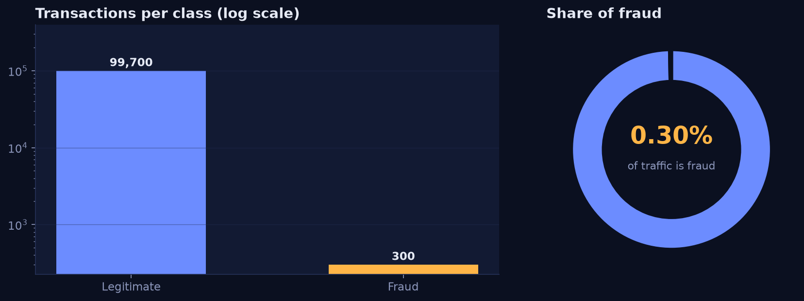
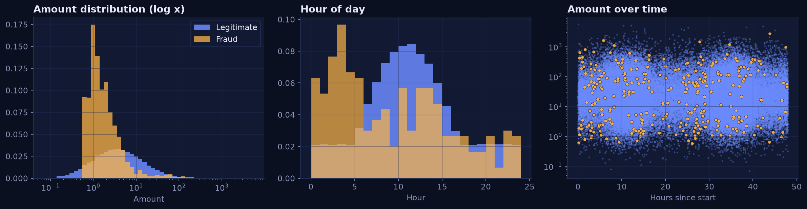
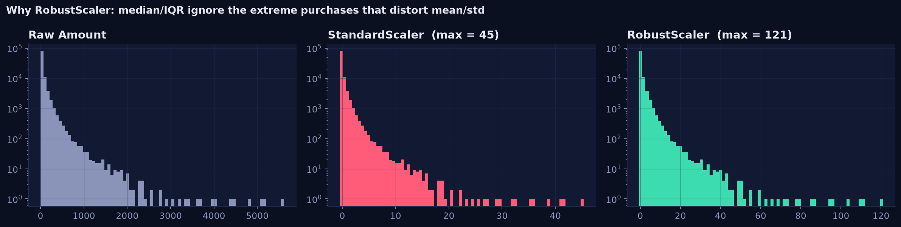
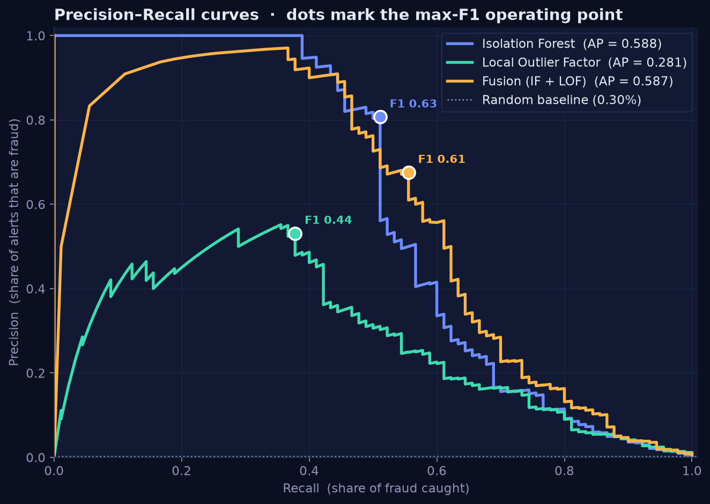
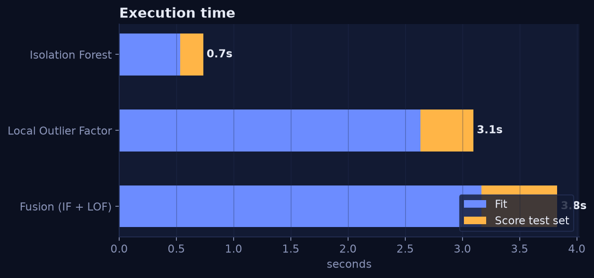
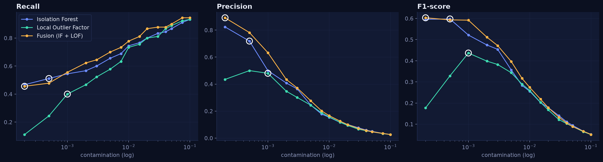
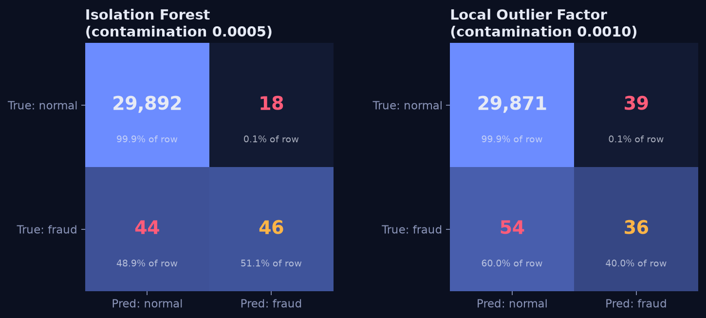
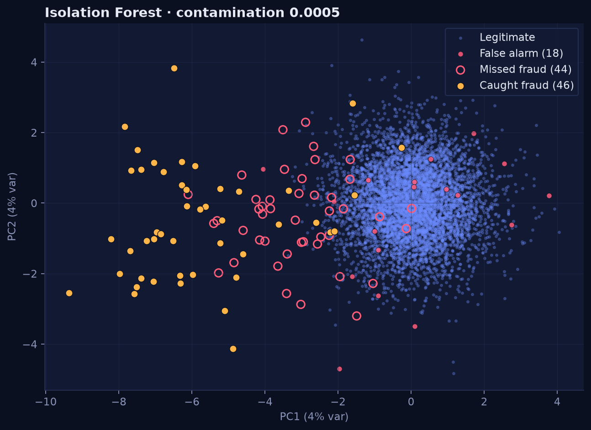

# Performance Analysis Report — SentinelPay

> **Data source:** Synthetic demo data (ULB-style). These numbers come from the synthetic ULB-style demo set; re-run on the real Kaggle `creditcard.csv` to obtain the final figures.
> **Hold-out set:** 30,000 transactions, 90 of them fraud.

## 1. Executive summary

We recommend Isolation Forest with a contamination of 0.0005. On the hold-out set it catches 51% of fraud at 72% precision, producing 18 false alarms among 30,000 transactions (false-positive rate 0.06%). Main risk: fraud patterns drift, so thresholds should be re-calibrated on fresh normal traffic regularly.

_Template summary (set `NVIDIA_API_KEY` to have the NVIDIA LLM write this section)._

**Recommendation.** Deploy **Isolation Forest** with a **contamination threshold of 0.0005**, which yields a
**recall of 51%**, **precision of 72%** (F1 0.60) and a false-positive rate of
**0.06%** (18 false alarms on 30,000 transactions).

## 2. Data & exploratory findings

| Metric | Value |
|---|---|
| Transactions | 100,000 |
| Fraud cases | 300 (0.300%) |
| Imbalance ratio | 1 : 332 |
| Accuracy of a model that always says "legitimate" | **99.70%** (the metric trap) |
| Median / mean Amount | $22.25 / $55.64 |
| Amount skewness | 11.6 |

**Preprocessing.** `Amount` (and `Time`) are scaled with `RobustScaler` (median / IQR). The scaler is fitted on normal
training rows only, so no information leaks from the test set or from fraud. 

## 3. Methodology

* **Training strategy:** detectors are trained on *normal* transactions only. A further 20 % of normal training rows are
  held out as a *calibration set*; the alert threshold is the `(1 − contamination)` quantile of calibration scores, so it
  needs **no fraud labels** and the false-positive rate lands close to the contamination value.
* **Isolation Forest:** 200 trees, `max_samples=512` – anomalies need fewer random splits to isolate.
* **Local Outlier Factor:** `n_neighbors=35`, `novelty=True`, trained on ≤ 20,000 rows.
* **Fusion (extra):** both scores are mapped to calibrated tail probabilities (`-log10 P(normal ≥ score)`) and averaged.
* **Model selection:** highest PR-AUC; if models are within 0.03 PR-AUC the lower-latency one wins (real-time constraint).
* **Metrics:** Precision, Recall, F1, PR-AUC, ROC-AUC, confusion matrices. Accuracy is deliberately not used.

## 4. Model comparison

| Model | PR-AUC (AP) | ROC-AUC | Best F1 | Fit (s) | Score test (s) | Latency (ms/txn) |
|---|---|---|---|---|---|---|
| Isolation Forest | 0.588 | 0.975 | 0.626 | 1.1 | 0.5 | 0.017 |
| Local Outlier Factor | 0.281 | 0.978 | 0.442 | 3.0 | 0.8 | 0.027 |
| Fusion (IF + LOF) | 0.587 | 0.981 | 0.610 | 4.0 | 1.3 | 0.044 |

**Reading the results**

* **Isolation Forest vs LOF:** Isolation Forest has the higher
  PR-AUC (0.588 vs 0.281).
  Isolation Forest also scores the test set 2× faster than LOF here, and LOF's
  neighbour search scales poorly with data size, which is why it is trained on a capped sample.
* **Fusion** reaches PR-AUC 0.587: combining a tree-based and a density-based view helps
  when each model misses different fraud, at the cost of running both.
* ROC-AUC is high for every model (> 0.97) *because of* the imbalance – PR-AUC is the honest metric.

## 5. Threshold tuning

**Scenario A – higher threshold (small contamination):** few false alarms, but fraud slips through.
**Scenario B – lower threshold (large contamination):** most fraud is caught, but many legitimate customers are challenged.

### Three defensible operating points

| Model | Strategy | contamination | Recall | Precision | False alarms | FPR | Fraud $ missed |
|---|---|---|---|---|---|---|---|
| Isolation Forest | Max F1 | 0.0005 | 51.1% | 71.9% | 18 | 0.06% | $2,313 |
| Isolation Forest | Min total cost | 0.0050 | 65.6% | 24.5% | 182 | 0.61% | $1,295 |
| Isolation Forest | Recall ≥ 80% | 0.0200 | 80.0% | 10.0% | 645 | 2.16% | $597 |
| Local Outlier Factor | Max F1 | 0.0010 | 40.0% | 48.0% | 39 | 0.13% | $4,121 |
| Local Outlier Factor | Min total cost | 0.0100 | 73.3% | 15.8% | 353 | 1.18% | $2,232 |
| Local Outlier Factor | Recall ≥ 80% | 0.0200 | 80.0% | 9.4% | 695 | 2.32% | $1,966 |
| Fusion (IF + LOF) | Max F1 | 0.0002 | 45.6% | 89.1% | 5 | 0.02% | $3,548 |
| Fusion (IF + LOF) | Min total cost | 0.0020 | 62.2% | 43.4% | 73 | 0.24% | $1,391 |
| Fusion (IF + LOF) | Recall ≥ 80% | 0.0150 | 81.1% | 12.6% | 506 | 1.69% | $758 |

### Sweep for Isolation Forest

| contamination | precision | recall | F1 | false alarms | missed fraud | FPR |
|---|---|---|---|---|---|---|
| 0.0002 | 0.824 | 0.467 | 0.596 | 9 | 48 | 0.03% |
| 0.0005 | 0.719 | 0.511 | 0.597 | 18 | 44 | 0.06% |
| 0.0010 | 0.500 | 0.544 | 0.521 | 49 | 41 | 0.16% |
| 0.0020 | 0.408 | 0.567 | 0.474 | 74 | 39 | 0.25% |
| 0.0030 | 0.365 | 0.600 | 0.454 | 94 | 36 | 0.31% |
| 0.0050 | 0.245 | 0.656 | 0.356 | 182 | 31 | 0.61% |
| 0.0075 | 0.178 | 0.689 | 0.283 | 286 | 28 | 0.96% |
| 0.0100 | 0.154 | 0.744 | 0.256 | 367 | 23 | 1.23% |
| 0.0150 | 0.117 | 0.767 | 0.203 | 522 | 21 | 1.75% |
| 0.0200 | 0.100 | 0.800 | 0.178 | 645 | 18 | 2.16% |
| 0.0300 | 0.076 | 0.833 | 0.140 | 906 | 15 | 3.03% |
| 0.0400 | 0.060 | 0.844 | 0.111 | 1200 | 14 | 4.01% |
| 0.0500 | 0.050 | 0.867 | 0.095 | 1482 | 12 | 4.95% |
| 0.0750 | 0.035 | 0.911 | 0.067 | 2291 | 8 | 7.66% |
| 0.1000 | 0.027 | 0.933 | 0.052 | 3064 | 6 | 10.24% |

## 6. Final recommendation

* **Model:** Isolation Forest.
* **Balanced option (max F1):** contamination **0.0005** → recall **51%**, precision **72%**, FPR **0.06%**.
* **Cost-optimal option ($):** contamination **0.0050** → total cost $1,777 (missed fraud + $2 per reviewed alert).
* **Recall-first (compliance) option:** contamination **0.020** reaches **80% recall** at the price of 645 false alarms (10% precision).

> *Example sentence for stakeholders:* "We recommend a contamination threshold of 0.0005 using Isolation Forest, which yields a
> recall of 51% with a false-positive rate of 0.06%."

## 7. Limitations & next steps

1. The threshold is tuned on the same hold-out set that is reported; in production use a separate validation window.
2. Fraud evolves – re-calibrate on fresh normal traffic on a schedule and monitor score drift.
3. Features are PCA-anonymised, so explanations are statistical (which components deviate), not business-level.
4. Next: add a supervised second stage for analyst-confirmed cases, streaming scoring (Kafka / Flink) and model-drift alerts.

---
*Generated by `python run_pipeline.py` · SentinelPay v1.0*
